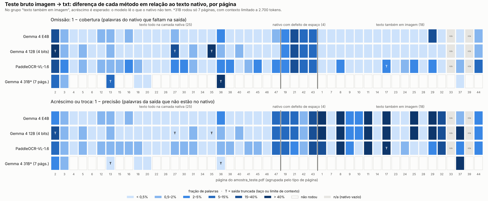

# Resultados do teste bruto imagem → txt (5 e 6/nov/2026)

Registro da primeira fase de testes com modelos reais, feita fora do `pdf_pipeline.py` (veja
`teste_ocr/LEIA-ME.md`). Este arquivo só traz métricas e palavras isoladas dos documentos (todos
públicos), nunca trechos longos.

- Métricas por página e método: [`teste_ocr_metricas.csv`](teste_ocr_metricas.csv). Para gerar de novo:
  `python teste_ocr/comparar.py --csv experimento/teste_ocr_metricas.csv`.
- Figura: [`teste_ocr_mapa.png`](teste_ocr_mapa.png), com omissão e acréscimo por página e por método.
- Estado: E4B, 12B e PaddleOCR-VL rodaram as 47 páginas. O 31B, por limite de hardware, rodou
  7 páginas escolhidas. A rodada das 40 restantes está pendente (comando na seção 13).
  **Atualize as seções 5, 7 e 10 quando ela terminar.**

---

## 1. Conclusões em uma página

1. **Nenhum método domina, e os erros são de tipos diferentes.** Os Gemma leem bem prints de tela e
   tabelas, mas "consertam" o texto. O PaddleOCR-VL é literal no texto impresso nítido, mas erra
   acentos, perde a estrutura das tabelas e quase não lê prints.
2. **O erro típico dos generalistas é fluente, e por isso invisível.** Os Gemma trocam uma palavra
   por outra plausível ("excetuadas" → "executadas", que inverte o sentido; "transplantio" →
   "transplante"), normalizam nomes e números ("RenovAgro" → "RenovaAgro"; "US$ 250,000" →
   "250.000"), corrigem erros do próprio documento e, na 12B, inventam a frase de um aviso ilegível.
   Nada disso aparece nas métricas de palavras: uma troca em 600 palavras ainda dá 99,8%.
3. **O tamanho ajuda nesse tipo de erro.** Nas 14 armadilhas (trechos conferidos na imagem), a E4B
   acertou 0, a 12B acertou 6 e o 31B acertou 9. O único erro do 31B está numa imagem ambígua, e as
   outras 4 armadilhas ficaram depois do corte de contexto, sem resultado. O Paddle acertou 11 e
   leu certo até a letra de ~5 pt de um formulário.
4. **Os laços de repetição são o modo de falha novo dos modelos maiores.** A 12B entrou em laço em
   3 de 47 páginas, todas com pontuação repetida (linha tracejada, campos `____`, sumário
   pontilhado), e cada laço perdeu a página inteira. O Paddle teve 1 laço e a E4B, nenhum. Com
   temperatura 0, os laços são determinísticos: rodar de novo não resolve.
5. **O texto nativo segue sendo a melhor fonte onde existe.** Todas as armadilhas estão em páginas
   com camada de texto, onde o nativo já tem a resposta certa. Os modelos só acrescentam algo onde
   há texto dentro de imagem, e nessas páginas o melhor leitor foi o 31B: na p37 ele leu certo o
   aviso minúsculo que a 12B inventou e que a E4B e o Paddle pularam.
6. **Votar entre modelos da mesma família não funciona.** E4B e 12B erram as mesmas palavras, então
   uma maioria simples teria escolhido "executadas". A discordância entre famílias diferentes
   (Gemma × Paddle) serve como alarme para revisão humana, não como juiz.
7. **Implicação para o pipeline:** manter a arquitetura híbrida. Usar o nativo nas 2.126 páginas
   `ok`, com os consertos determinísticos de espaço. Chamar o modelo só nas ~17 páginas com texto
   real em imagem (até ~65, se contarmos as que têm só logotipo ou título). Com tão poucas
   páginas, o modelo mais lento e mais fiel (o 31B, se a rodada completa confirmar) é viável.

---

## 2. Pergunta e escopo

**Pergunta:** qual a qualidade *bruta* de cada método ao transformar uma página em texto, sem
limpeza nenhuma? A resposta deve servir para decidir como reorganizar o pipeline.

- **Dentro do escopo:** transcrição de página inteira, um prompt por modelo e temperatura 0.
- **Fora do escopo:** limpeza, pipeline oficial com detector de layout e gabarito humano.

---

## 3. Metodologia

### 3.1 Amostra
- `teste_ocr/amostra_teste.pdf`: 47 páginas dos 6 PDFs (2.322 páginas no total), montadas por
  `teste_ocr/montar_pdf_teste.py` com semente 2026.
- As páginas foram sorteadas por tipo, com cotas para 15 tipos (texto corrido, tabela, tabela
  densa, formulário, slide, texto em imagem, sumário pontilhado etc.), sem páginas repetidas entre
  documentos e com distância mínima entre páginas do mesmo documento.
- `teste_ocr/manifesto.csv` liga cada página à sua origem.
- Imagens: PNG com 1920 px no maior lado, geradas pelo `pdf_to_image/pdf_para_imagens.py`. São as
  mesmas imagens para todos os modelos.

### 3.2 Métodos e configuração

| Método (pasta em `saidas/`) | Checkpoint | Pesos | Prompt | `max_tokens` | Concorrência |
|---|---|---|---|---|---|
| `nativo` | camada de texto (PyMuPDF `get_text`) | — | — | — | — |
| `gemma4-e4b__gemma_fiel` | `google/gemma-4-E4B-it` | BF16 | `gemma_fiel.txt` | 8192 | 4 |
| `gemma4-12b__gemma_fiel` | `google/gemma-4-12B-it-qat-w4a16-ct` | 4 bits (QAT) | `gemma_fiel.txt` | 8192 | 4 |
| `paddleocr-vl-1.6__paddleocr_ocr` | `PaddlePaddle/PaddleOCR-VL-1.6` | BF16 | `OCR:` | 8192 | 4 |
| `gemma4-31b-ctx2700__gemma_fiel` | `google/gemma-4-31B-it-qat-w4a16-ct` | 4 bits (QAT) | `gemma_fiel.txt` | **1300** | **1** |

Configuração comum:
- **Requisição:** temperatura 0, semente 0, uma imagem por requisição, com a imagem antes do texto.
- **Servidor:** vLLM 0.33.0 (`~/venv-vllm`) na RTX A5500 de 24 GB da máquina compartilhada
  "chineque", na porta 8011.
- **Gemma:** `max_soft_tokens` 1120, `--enforce-eager` e `VLLM_USE_FLASHINFER_SAMPLER=0`.

Os comandos exatos estão na seção 13.

### 3.3 Medidas
Ainda não há gabarito, então a régua é o nativo. Pelo CLAUDE.md, ele é exato nas páginas nascidas
digitais: 98,8% de concordância com um OCR independente, e os defeitos são só de espaço.

O `teste_ocr/comparar.py` calcula três medidas por página:
- **cobertura:** fração das palavras do nativo que aparecem na saída. Mede omissão.
- **precisão:** fração das palavras da saída que existem no nativo. Mede acréscimo ou troca.
- **números:** fração dos números do nativo que aparecem idênticos na saída.

As páginas são lidas em três grupos, pelo tipo no manifesto:

| Grupo | Páginas | Como ler |
|---|---|---|
| `completo` | 25 | todo o texto está na camada nativa, então qualquer diferença é do método |
| `imagem` | 18 | prints, slides, capas e fluxograma: precisão abaixo de 1 é esperada |
| `defeito` | 4 | o nativo tem palavras grudadas ou letras espaçadas, então parte da diferença é culpa dele |

Duas verificações complementam as medidas:
- **Armadilhas** (`teste_ocr/armadilhas.csv`): 14 trechos conferidos na imagem ampliada, todos em
  lugares onde algum método errou.
- **Inspeção visual:** toda discrepância citada aqui foi conferida na imagem da página.

### 3.4 Limites da medida
- **Saco de palavras:** não mede ordem nem estrutura. Uma tabela desmontada e uma bem formatada
  podem ter a mesma nota.
- **Erros raros somem na média:** uma palavra trocada em 600 vale ~0,2%. Por isso existem as
  armadilhas.
- **A régua erra no grupo `defeito`:** lá, a "precisão baixa" dos modelos vem de terem separado
  corretamente palavras que o nativo grudou.
- **O nativo é incompleto no grupo `imagem`:** ali, só a inspeção visual distingue texto lido de
  texto inventado.

---

## 4. Estratégia

1. **E4B primeiro, como teste de fumaça.** É o modelo mais rápido e serviu para validar servidor,
   prompt, cliente e retomada.
2. **Depois, o maior que coubesse.** A conta de memória mostrou que o 12B em 4 bits ocupa menos
   que a E4B em BF16, e ele rodou as 47 páginas.
3. **PaddleOCR-VL como referência especializada.** É de outra família, treinado só para OCR.
4. **31B por último, num teste dirigido.** Como ele não cabe com contexto útil, rodamos primeiro as
   7 páginas onde os menores erraram, para responder "o tamanho resolve esses erros?". Só depois
   rodamos as outras 40, para ver os erros que ele próprio introduz.

---

## 5. Resultados

### 5.1 Visão geral

| | E4B | 12B | Paddle | 31B* |
|---|---|---|---|---|
| Páginas | 47 | 47 | 47 | 7 |
| Grupo `completo`: cobertura média | 0,987 | 0,911 (0,997 sem os laços) | 0,976 | 0,886 (0,963 sem as truncadas) |
| Grupo `completo`: precisão média | 0,992 | 0,985 | 0,989 | 0,993 |
| Grupo `completo`: números | 0,951 | 0,912 | 0,973 | 0,903 |
| Páginas `completo` com ≥ 0,99 nos dois sentidos | 21/25 | 21/25 | 11/25 | 3/6 |
| Laços ou truncadas | 0 | 3 laços | 1 laço | 2 cortes de contexto |
| Armadilhas certas (de 14) | 0 | 6 | 11 | 9 (+4 depois do corte) |
| Tempo efetivo por página | 7,5 s | 31,3 s | 5,0 s | 116 s |
| Tokens/s por requisição (mediana) | 19 | 15 | 59 | 7 |
| Pesos na GPU / KV cache livre | 14,5 / 6,2 GiB | 8,3 / 12,3 GiB | 1,8 GiB / folga | 19,2 / 2,3 GiB |
| KV cache por token | ~38 KB | ~196 KB | — | ~860 KB |

\*31B com contexto de 2.700 tokens (`max_tokens` 1300) e concorrência 1. Ele rodou só as páginas
2, 3, 13, 18, 20, 36 e 37, que foram escolhidas porque os outros erraram nelas. Os números dele
não são comparáveis aos das outras colunas.

Sobre a coluna de números: na E4B, o 0,951 vem sobretudo de "US$ 250,000" → "250.000" (16
números na p20) e do código de 14 zeros. No Paddle, vem de números perdidos em tabelas densas,
por exemplo "100.000,00" e "8.000.000,00" na p30.

O tempo efetivo é o tempo de GPU ocupado dividido pelo número de páginas, já contando a
concorrência e os laços.

### 5.2 Armadilhas (conferidas na imagem)

| Pág. | Esperado | E4B | 12B | Paddle | 31B |
|---|---|---|---|---|---|
| 2 | linha "FOMOS AUTORIZADOS…" (≈5 pt) | omitiu | laço | ok | ok |
| 2 | "PF1=Guia" | PFI | laço | ok | ok |
| 3 | "transplantio" | transplante | transplante | ok | ok |
| 3 | "julho de 2024"¹ | 2021 | 2021 | ok | 2021 |
| 13 | "excetuadas" | executadas | executadas | ok | ok |
| 13 | "RenovAgro" (11×) | RenovaAgro | ok | RenovAgr (4/11) | 6/11 (corte) |
| 13 | "Palmáceas" | Palmeáceas | Palmeáceas | ok | depois do corte |
| 18 | código com 14 zeros | 16 zeros | ok | ok | ok |
| 20 | "US$ 250,000" | 250.000 | ok | ok | ok |
| 36 | "CRISSIUMAL", "GIRUÁ" | Crissumal, Giurá | ok | ok | depois do corte |
| 36 | estados nas linhas "Estado" | sumiram | ok | ok | ok |
| 37 | aviso minúsculo do app | omitiu | inventou outra frase | omitiu | ok (1 palavra errada²) |
| 37 | contador "4/20" | omitiu | 4/10 | omitiu | ok |

¹ No PDF, o número da página "291" está impresso por cima do "4" de "2024". A imagem é ambígua,
então esse caso não conta como "conserto" do modelo.
² No print está "Deixei mais informações aqui", e o 31B escreveu "Detalhes".

Erros fora das armadilhas, mas da mesma natureza:
- **"Correção" de um erro do próprio documento:** na p18, o original diz "condiçoes", sem acento.
  E4B, 12B e Paddle escreveram "condições"; só o 31B manteve.
- **"condômino" → "condomínio":** 12B e Paddle, na p30.
- **"bovinocultura" → "bovinicultura":** E4B, na p30.

### 5.3 Por tipo de página
- **Texto corrido, números e links:** todos ficam acima de 0,99. O Paddle é o único que erra
  acentos com frequência ("consorcios" 4× na p15, "quadrágésimo").
- **Tabelas:**
  - Os Gemma mantêm linhas com ` | `, mas quebram células de duas linhas em linhas separadas.
  - A E4B perdeu os rótulos de estado na tabela densa da p36.
  - O Paddle põe uma célula por linha, sem estrutura, e perde números em tabelas densas (p16, p30).
- **Formulários:**
  - A E4B omite os campos `___/___/____`.
  - A 12B escreve esses campos com Markdown escapado (`\_\_\_`) e põe as linhas da tabela entre
    `| … |`, apesar de o prompt pedir texto sem Markdown.
  - A p2 e a p27 têm pontuação repetida, e a 12B entrou em laço nelas.
- **Sumários pontilhados:** a 12B entrou em laço na p35, a E4B e o Paddle passaram.
- **Texto em imagem (prints de app e de sistema):**
  - Os Gemma leem as telas sem inventar, exceto a 12B na letra ilegível da p37.
  - O Paddle, com a página inteira reduzida a ~1 MP, lê mal ("CBE 2º trimestre" → "CSE 2º
    triensite", "CPF/CNPJ" → "CFF/CHRPJ", "Ativos" → "Adivos") ou nem lê as telas (p25, p29).
- **Nativo com defeito de espaço:** todos os modelos separam as palavras que o nativo grudou e
  juntam as letras espaçadas. É a única vantagem deles sobre o nativo em páginas com camada de
  texto, e ela tem conserto determinístico.
- **Página em branco (p33):** os Gemma responderam `[SEM TEXTO]`, como pede o prompt, e o Paddle
  devolveu uma resposta vazia. As duas respostas estão certas.

### 5.4 Figura



---

## 6. Taxonomia dos erros

Os erros estão ordenados do mais para o menos perigoso para a whitelist. Erro "invisível" é o que
só se percebe olhando a imagem.

| Tipo | Exemplos | Quem | Invisível? |
|---|---|---|---|
| Invenção de texto ilegível | aviso da p37 reescrito com outra frase | 12B | sim |
| Troca por palavra plausível | executadas, transplante, condomínio, plantão, Sudeste | E4B, 12B, Paddle | sim |
| Normalização de nome ou número | RenovaAgro, 250.000, Crissumal | E4B | sim |
| "Correção" do original | condiçoes → condições | E4B, 12B, Paddle | sim |
| Número alterado | 14 → 16 zeros; PF1 → PFI | E4B | sim, mas a checagem de números pega |
| Omissão de letra miúda | linha "FOMOS AUTORIZADOS"; campos de data | E4B | parcial (a cobertura cai) |
| Estrutura de tabela perdida | estados sumidos (E4B); uma célula por linha (Paddle) | E4B, Paddle | parcial |
| Laço de repetição | tracejado, `____`, pontilhado; print do app | 12B (3), Paddle (1) | não (sinal `truncado`) |
| Erro de caractere | consorcios, Aliquotas, triensite, RenovAgr | Paddle | não: não-palavras, detectáveis por vocabulário |
| Formatação indevida | `\_`, `\| … \|` | 12B | não |
| Imagem ambígua | rodapé "2024" com o "291" por cima | todos os Gemma | — |

---

## 7. Previsões × resultados

| Previsão (de onde veio) | Resultado |
|---|---|
| "E4B em BF16 cabe com folga" (CLAUDE.md) | **Errada.** São 8B de parâmetros com embeddings, e os pesos ocupam 14,5 GiB. Ela sobe com 0,90 e flags enxutas, com 6,2 GiB de KV cache. |
| A queda em `determine_available_memory` seria falta de memória por GPU compartilhada (primeiro diagnóstico desta fase) | **Errada.** A GPU estava vazia. A causa era o amostrador da FlashInfer tentando compilar kernels sem `nvcc`. |
| "12B precisa do vLLM nightly" (CLAUDE.md e receita do vLLM) | **Errada.** Subiu no vLLM 0.33.0 estável. |
| "31B W4A16 tem ~18 GB e pode não subir" (CLAUDE.md) | **Pior que o previsto.** O arquivo tem 23,3 GB, e `--cpu-offload-gb` não liberou memória da GPU com pesos W4A16 (19,0 GiB com 6 GB fora; 19,2 com 10). O contexto máximo ficou em ~2.700 tokens. |
| "Maior lê melhor" | **Em parte.** 12B e 31B consertam nomes, números e tabelas, e o 31B consertou quase todas as armadilhas. Mas a 12B trouxe laços e invenção. |
| "Generalista tende a corrigir o texto" (CLAUDE.md, teste no `chat.py`) | **Confirmada.** Erros graves nas armadilhas da E4B e da 12B. |
| "O Paddle sofre com letra miúda na página inteira" (LEIA-ME) | **Depende.** O impresso miúdo (~5 pt) ele leu certo; os prints de tela, não. |
| "Truncar em 8.192 tokens é sinal de laço" | **Confirmada.** As 4 truncadas eram laços, e a maior resposta legítima teve 2.297 tokens (p36, E4B). |
| "As p35 e p41 (sumários) podem entrar em laço" | **Metade.** A p35 entrou (12B), a p41 não. Também houve laço nas p2 (tracejado) e p27 (`____`). |
| "O `[repeticao]` da p3 na 12B é falso positivo" | **Confirmada.** São 8 linhas de data legitimamente iguais. |
| "Votar entre modelos resolveria" (ideia de abordagem múltipla) | **Errada para a mesma família.** E4B e 12B erram igual, e 2 de 3 escolheriam "executadas". |

---

## 8. Problemas operacionais e soluções

| Problema | Causa | Solução |
|---|---|---|
| Porta 8000 ocupada na chineque | outro serviço da máquina compartilhada | `--port 8011`; no cliente, sempre `--url` e `--modelo` explícitos |
| `ModuleNotFoundError: httpx` | o `cd ~/pdf-pipeline` falhou (o clone está em `~/teste/pdf-pipeline`), e o `&&` não ativou o `.venv` | caminho certo; conferir o `(.venv)` no prompt |
| `vllm-e4b.log` não foi criado | comando de várias linhas com `\` quebrou ao colar, e o `\| tee` ficou de fora | comando numa linha só |
| "Engine core initialization failed" | é a mensagem genérica do processo da API | `grep -n "EngineCore" log \| grep -v " INFO " \| tail -n 40` mostra a causa real |
| `Could not find nvcc and default cuda_home='/usr/local/cuda' doesn't exist` | o amostrador top-k/top-p da FlashInfer compila kernels na hora (JIT), e a chineque só tem o driver, sem o CUDA toolkit | `VLLM_USE_FLASHINFER_SAMPLER=0` (temperatura 0 nem usa top-k/top-p). Alternativa: `vllm download-kernels` |
| `generation_config.json` impõe temperatura 1,0, top-k 64 e top-p 0,95 | padrão do modelo | inofensivo: o cliente manda temperatura 0, e o vLLM ignora top-k/top-p |
| Cliente "parado" por 9 min (12B, p2) | laço até 8.192 tokens | esperar; `--timeout 1800`, para o cliente não repetir o laço 4 vezes |
| 31B: `ValueError: To serve at least one request with the model's max seq len…` | KV cache de ~860 KB por token e só 1,8 a 2,3 GiB livres | contexto 2.700, `max_tokens` 1300, concorrência 1 |
| `--cpu-offload-gb` sem efeito no 31B | hipótese: as camadas W4A16 são reorganizadas para o kernel Marlin e a cópia usada fica na GPU | não há flag que resolva; o 31B fica limitado nesta GPU |
| Processo morre se o VS Code desconectar | terminal do VS Code | `tmux` (`Ctrl+b c`, `Ctrl+b d`, `tmux attach -t ocr`) |

---

## 9. Projeções

Os tempos abaixo saem desta amostra, que tem mais páginas difíceis que a média. Use-os como
ordem de grandeza.

| Método | Tempo efetivo por página | Modelo em todas as 2.322 páginas | Híbrido: ~17 a 65 páginas |
|---|---|---|---|
| E4B | 7,5 s | ~4,8 h | 2 a 8 min |
| 12B | 31 s | ~20 h (com laços) | 9 a 34 min |
| Paddle | 5,0 s | ~3,2 h | 1 a 5 min |
| 31B (contexto 2.700) | ~116 s | ~75 h, com páginas longas cortadas | 33 min a 2 h |

As ~17 páginas são as que a triagem de 05/11 achou com texto real em imagem: 13 `misto`, 3 `ok`
do assets_2 e a capa bacen:33. As ~65 incluem as 48 `misto` com só logotipo ou título.

Com o modelo restrito a essas páginas, até o 31B cabe numa tarde. E a revisão humana das páginas
em que as famílias discordam também fica viável: são dezenas de páginas, não milhares.

---

## 10. Recomendações

1. **Manter o pipeline híbrido.** Nativo nas páginas `ok`, com os consertos determinísticos de
   espaço que o CLAUDE.md já lista (palavras grudadas, ligadura partida, letras espaçadas).
2. **Mudar a regra das páginas `misto`.** Hoje o `exportar` troca o nativo inteiro pelo texto do
   modelo. A proposta é manter o nativo como base e acrescentar só o texto da imagem, ou seja, as
   linhas do modelo que não existem no nativo. Isso tira os erros fluentes dos modelos de todo o
   texto que o nativo já tem certo.
3. **Modelo para as páginas com texto em imagem:** o 31B, se a rodada completa confirmar que ele
   não traz laços nem invenção; senão, a E4B, que não inventou e não entrou em laço. O Paddle não
   serve para prints de tela com a página inteira. Talvez sirva com o pipeline oficial de layout
   e recortes, o que ainda precisa ser testado.
4. **Usar a discordância entre famílias (Gemma × Paddle) para marcar páginas para revisão**, nunca
   para decidir por maioria.
5. **Se a 12B for usada:**
   - reforçar no prompt a proibição de Markdown;
   - usar `max_tokens` de ~3.000, para cortar os laços cedo, já que nenhuma resposta legítima
     passou de 2.300 tokens.
6. **Fazer o gabarito humano onde o modelo importa.** São as ~17 páginas com texto em imagem, e
   não 40 páginas estratificadas, que seriam quase todas `ok`.

---

## 11. Ameaças à validade

- **Sem gabarito:** a régua é o nativo, que é exato no grupo `completo`, mas incompleto ou
  defeituoso nos outros grupos.
- **Amostra pequena:** com 47 páginas, uma página vale ~2%. O 31B tem só 7 páginas, escolhidas
  por viés: são justamente as que os outros erraram.
- **Configurações diferentes:**
  - o 31B usou `max_tokens` 1300 e contexto 2.700;
  - o Paddle recebeu a página inteira, fora do seu fluxo oficial;
  - cada família usou o prompt próprio.
- **Determinismo parcial:** com temperatura 0 e concorrência acima de 1, o vLLM não garante a
  mesma resposta entre rodadas, porque não é *batch-invariant*. A E4B, a 12B e o Paddle rodaram
  com 4 requisições em paralelo.
- **Um prompt só por família:** variações de prompt não foram testadas.
- **A métrica é de vocabulário:** a ordem e a estrutura foram avaliadas só por inspeção.

---

## 12. Próximos passos

1. Terminar a rodada completa do 31B (40 páginas), rodar `comparar.py` e atualizar este arquivo.
2. Decidir e implementar no `pdf_pipeline.py` a regra de mescla para páginas `misto`.
3. Montar o gabarito das ~17 páginas com texto em imagem e medir os modelos contra ele.
4. Testar o pipeline oficial do PaddleOCR-VL (detector de layout e recortes) nas páginas de prints.
5. Rever o `EXPERIMENTO.md`. Pela seção 0 dele ("poucas páginas"), o experimento de 5 modelos
   provavelmente não compensa.

---

## 13. Reprodução

Na chineque, na pasta `~/teste/pdf-pipeline`, com o servidor numa janela do tmux e o cliente em
outra:

```bash
# servidor: E4B (troque o checkpoint e o --served-model-name para o 12B: google/gemma-4-12B-it-qat-w4a16-ct, gemma4-12b)
VLLM_USE_FLASHINFER_SAMPLER=0 ~/venv-vllm/bin/vllm serve google/gemma-4-E4B-it --served-model-name gemma4-e4b --host 127.0.0.1 --port 8011 --gpu-memory-utilization 0.90 --max-model-len 16384 --max-num-seqs 4 --max-num-batched-tokens 4096 --enforce-eager --limit-mm-per-prompt '{"image": 1, "audio": 0}' --mm-processor-kwargs '{"max_soft_tokens": 1120}' --reasoning-parser gemma4 2>&1 | tee ~/vllm-e4b.log

# servidor: 31B (limite de hardware)
VLLM_USE_FLASHINFER_SAMPLER=0 ~/venv-vllm/bin/vllm serve google/gemma-4-31B-it-qat-w4a16-ct --served-model-name gemma4-31b --host 127.0.0.1 --port 8011 --gpu-memory-utilization 0.95 --cpu-offload-gb 10 --max-model-len 2700 --max-num-seqs 1 --max-num-batched-tokens 4096 --enforce-eager --limit-mm-per-prompt '{"image": 1}' --mm-processor-kwargs '{"max_soft_tokens": 1120}' --reasoning-parser gemma4 2>&1 | tee ~/vllm-31b.log

# servidor: PaddleOCR-VL-1.6
VLLM_USE_FLASHINFER_SAMPLER=0 ~/venv-vllm/bin/vllm serve PaddlePaddle/PaddleOCR-VL-1.6 --served-model-name paddleocr-vl-1.6 --host 127.0.0.1 --port 8011 --trust-remote-code --max-num-batched-tokens 16384 --no-enable-prefix-caching --mm-processor-cache-gb 0 --enforce-eager --gpu-memory-utilization 0.90 2>&1 | tee ~/vllm-paddle.log

# cliente (E4B; para os outros, troque --modelo e --prompt)
source .venv/bin/activate
python teste_ocr/transcrever.py vlm --url http://127.0.0.1:8011/v1 --modelo gemma4-e4b --prompt teste_ocr/prompts/gemma_fiel.txt --timeout 1800 --obs "..."
python teste_ocr/transcrever.py vlm --url http://127.0.0.1:8011/v1 --modelo gemma4-31b --metodo gemma4-31b-ctx2700__gemma_fiel --prompt teste_ocr/prompts/gemma_fiel.txt --concorrencia 1 --max-tokens 1300 --timeout 3600 --obs "..."

# análise (em qualquer máquina com a pasta saidas/)
python teste_ocr/comparar.py
python teste_ocr/comparar.py --detalhe 13
python teste_ocr/comparar.py --csv experimento/teste_ocr_metricas.csv
```

As flags exatas de cada rodada estão no campo `observacao` do `config.json` de cada pasta de
`saidas/`.
